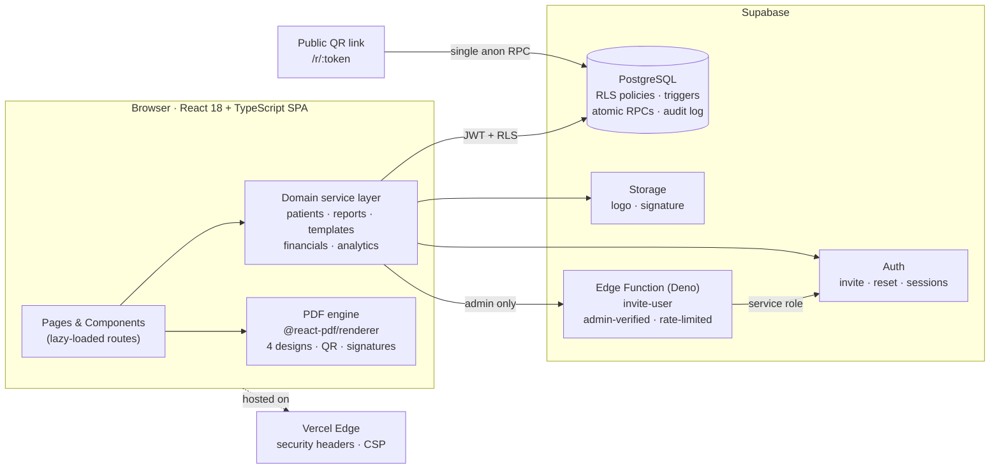

<div align="center">

# LabSwift

### The lab information system that pathology labs run their day on

**Patient intake → test entry → auto-flagged results → branded PDF reports → billing & analytics**
All in one fast, secure web app.

[](https://labswift-demo.vercel.app)


</div>

---

## In production

LabSwift began as a freelance project for working diagnostic labs. It is still part of their daily workflow.

<div align="center">

| **10,000+** | **6+ months** | **Daily** | **0 → 1** |
| :---: | :---: | :---: | :---: |
| lab reports generated | in continuous production use | used by front-desk staff and pathologists | designed, built, shipped and maintained by one engineer |

</div>

> **About this repository:** this is my public demo build. It is a separate codebase and deployment from the client's production system, so no client or patient data is here.
> **Try it:** [labswift-demo.vercel.app](https://labswift-demo.vercel.app)

---

## The problem

Small pathology labs often run on paper registers, Excel sheets and Word templates. That costs them in four ways:

- **Slow turnaround.** Staff retype patient details and reference ranges for every report.
- **Clinical risk.** Abnormal values are spotted by eye, and wrong-gender reference ranges slip through.
- **Revenue leakage.** Partial payments, discounts and outstanding dues are tracked loosely or not at all.
- **No audit trail.** Anyone can quietly change a finalised report.

LabSwift replaces that workflow with one system that a non-technical lab assistant can learn in an afternoon.

---

## Highlights

| | |
| :--- | :--- |
| 🧪 **Template engine for any test** | Labs build their own tests (CBC, LFT, KFT, lipid profile, thyroid, urine routine, Widal matrix…) with units and **gender-specific reference ranges**. Out-of-range values are flagged automatically. |
| 📄 **Report PDFs in the browser** | Branded, print-ready PDFs are generated on the device, so the server does no PDF work. There are **4 selectable report designs**, a logo watermark, an accent colour, and an optional digital signature. |
| 📚 **Combined patient reports** | Pick reports from a patient's timeline (grouped as *Today*, *Yesterday*, and by date) and export them as **one multi-page PDF**, ready to print or send on WhatsApp. |
| 🔗 **QR-verified reports** | Each report can carry a QR code that links to a **tokenised public copy**. The copy leaves out billing and contact details, and the link can be revoked per report. |
| 💰 **Billing built for real labs** | Reports start as *Unpaid*. Staff can record them as Paid, Partial (with live balance due), Free or Unpaid, and apply flat or percentage discounts. |
| 📊 **Analytics & financials** | Revenue, collections, dues, and test mix, shown with interactive charts for the lab owner. |
| 👥 **Team management** | Invite-only onboarding, Admin/Staff roles, account deactivation, and secure password setup and reset flows. |
| ⌨️ **Fast data entry** | Staff can move through every form with Enter and the arrow keys, which matters when the same form is filled 100 times a day. |

---

## Engineering deep-dive

This app handles **medical and financial records**, so it was built with **security and data integrity as hard requirements** rather than add-ons.

### 🔐 Security is enforced in the database

- **PostgreSQL Row-Level Security on every table.** The UI route guard is only for user experience; the database itself decides who can read or write each row.
- **Security audit and fix pass (S1–S11).** I audited the system for privilege-escalation and data-exposure issues, then fixed them in SQL migrations:
  - **Database triggers block self-promotion.** Only an admin can change a user's `role`, `isActive` or `email`.
  - **New sign-ups start as inactive Staff.** Accounts are created only through a server-side invite function.
  - **Finalised reports are locked for non-admins.** Every change to them is written to an `audit_logs` table by triggers, which clients cannot write to directly.
- **Least-privilege public access.** The anonymous role can run exactly **one** RPC: it returns finalised reports for a valid random token, without billing or contact data.
- **Hardened edge function for invites (Deno).** It verifies the caller is an active admin, checks the request origin against an allow-list (CORS), validates input, and **rate-limits** invites. It is the only code path that uses the service-role key.
- **Security headers at the edge:** HSTS, X-Frame-Options, Permissions-Policy, and a Content-Security-Policy (report-only).

### 🧱 Data integrity

- **Atomic report saves.** Creating or updating a report runs as a single Postgres transaction (`create_report_atomic` / `update_report_atomic`). Any failure rolls back everything, **including the report number**, so the sequence never has gaps or orphaned rows.
- **Templates are soft-deleted.** Fields are versioned out instead of deleted, so a report from six months ago still renders exactly as it was issued.
- **Sequences generated on the server.** Patient codes and report numbers come from Postgres functions, so two staff members saving at the same moment can't get the same number.
- **Draft protection.** Draft reports can't be exported as PDFs, and unsaved-changes guards prevent accidental data loss.

### ⚡ Performance

- **Route-level code splitting plus intent-based prefetching.** A page's JavaScript chunk starts downloading when the user hovers its link, so navigation feels instant.
- **Request de-duplication cache.** Concurrent callers share a single in-flight request. Entries expire by TTL, and a generation counter **prevents stale writes** when data is invalidated mid-request.
- **Parallel aggregate queries.** Dashboard counts use `HEAD` + `count: exact` queries fired in parallel, and indexes were added to the hottest query paths.
- **PDFs generated on the client.** Uploaded logos and signatures are re-encoded in the browser so the PDF engine renders them reliably.

---

## Architecture



**Design choice:** the app has no custom API server. Authorization lives in Postgres (RLS, triggers and `SECURITY INVOKER` RPCs), so the browser can talk to the database directly and still can't bypass the rules. This keeps hosting costs close to zero for a small lab, and there is one source of truth for permissions.

---

## Tech stack

| Layer | Technology |
| :--- | :--- |
| **Frontend** | React 18, TypeScript (strict), React Router 6, Tailwind CSS |
| **Build & hosting** | Vite 5, Vercel (edge headers, SPA rewrites, Speed Insights) |
| **Database** | PostgreSQL via Supabase: RLS, triggers, PL/pgSQL RPCs, indexes |
| **Auth** | Supabase Auth: invite-only onboarding, recovery flows, role-based access |
| **Serverless** | Supabase Edge Functions (Deno) |
| **Documents** | `@react-pdf/renderer`, `qrcode` (vector QR) |
| **Data viz** | Recharts |
| **UX** | Lucide icons, Sonner toasts, date-fns |

---

## Project structure

```text
src/
├── pages/                # Route-level screens (lazy-loaded)
│   ├── patients/         # Intake, profile, report timeline
│   ├── reports/          # Create, edit, view, finalise
│   └── admin/            # Templates, users, financials, analytics, settings
├── components/
│   ├── shared/           # LabReportPDF, PaymentModal, TemplateForm, …
│   ├── settings/         # PDF design picker with live thumbnails
│   └── routing/          # Auth and role guards
├── lib/
│   ├── services/         # One module per domain; all data access goes through here
│   ├── cache.ts          # De-duplicating TTL cache with generation-based invalidation
│   ├── preload.ts        # Intent-based route prefetching
│   └── reportTemplates.ts# PDF design catalogue
├── hooks/                # Keyboard navigation, unsaved-changes guard, auth
└── types/                # Domain types

supabase/
├── migrations/           # Versioned SQL: schema, RLS, triggers, RPCs, indexes
└── functions/invite-user # Deno edge function for secure user provisioning
```

---

## Running locally

**Prerequisites:** Node.js 18+ and a free [Supabase](https://supabase.com) project.

```bash
git clone https://github.com/rafrafreza/labswift-demo.git
cd labswift-demo
npm install
cp .env.example .env.local   # then fill in the values below
```

```env
VITE_SUPABASE_URL="https://<your-project>.supabase.co"
VITE_SUPABASE_ANON_KEY="<your-anon-key>"
VITE_APP_URL="http://localhost:5173"
```

1. **Database.** Run the scripts in `supabase/migrations/` in numeric order in the Supabase SQL Editor.
2. **Invites.** Deploy the edge function with `supabase functions deploy invite-user`.
3. **Auth settings.** In Supabase, add `<your-site>/login` to *Auth → URL Configuration → Redirect URLs*, and turn **off** public sign-ups.
4. **Start the app:**

```bash
npm run dev        # http://localhost:5173
npm run build      # type-check + production build
npm run typecheck  # type-check only
```

---

## What this project shows

- **End-to-end product ownership.** I gathered requirements from lab owners, then designed, built, deployed and supported the system in production.
- **Software that real users depend on.** It has handled 10,000+ reports over 6+ months, and I fix and ship based on feedback from the people using it every day.
- **Security-first backend design.** Authorization is defined in the database, the system went through an audit-and-fix pass, and access follows least privilege.
- **Product judgment.** Billing and PDF features are modelled on how labs actually work rather than on idealised flows.
- **Performance work.** Code splitting, prefetching, request de-duplication and query optimisation.

---

<div align="center">

### Built by [Rafraf Reza](https://github.com/rafrafreza)

**Open to AI Engineer / GenAI Engineer / Software Engineer roles**: remote worldwide, or hybrid/on-site in India.

If you're hiring or want something similar built, reach out via my [GitHub profile](https://github.com/rafrafreza).

⭐ Star this repo if you found it interesting.

</div>

---

<sub>© Rafraf Reza. Demo build shared for portfolio purposes. The production deployment and client data are private. All rights reserved.</sub>
